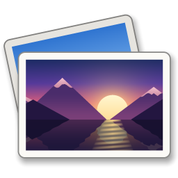
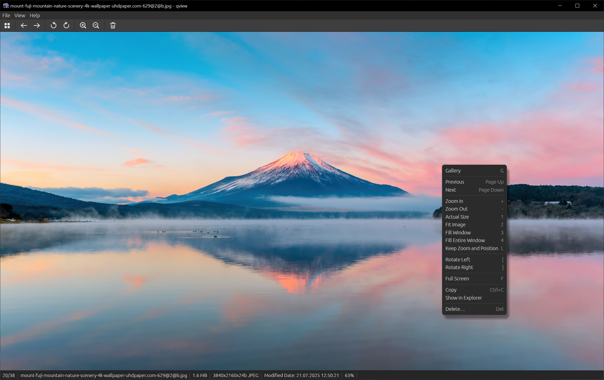
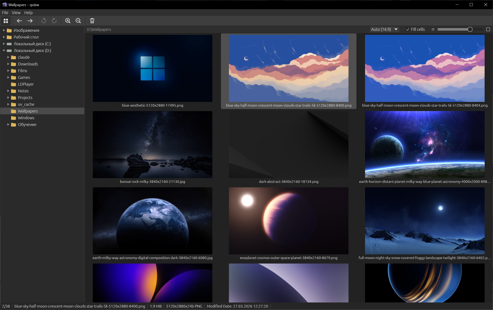
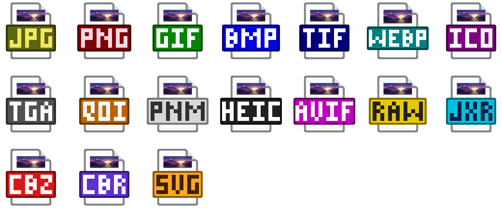

<p align="center">
  
</p>

<h1 align="center">qview</h1>

<p align="center">A fast and simple image viewer for Windows</p>

<p align="center">
  <a href="https://github.com/Fan4Metal/qview/releases/latest"></a>
  
  
  <a href="#license"></a>
</p>

<p align="center"><b>English</b> | <a href="README.ru.md">Русский</a></p>

qview is a fast and simple image viewer for Windows. It opens an image in a fraction of a second, browses the other images of its folder without delays and has no settings dialog: the few options are in the menus.



## Features

- **Fast**: the first image appears about 0.2 s after start-up, and the neighbouring images are decoded in advance, so that browsing has no delays.
- **Many formats**: JPEG, PNG, GIF, WebP, TIFF, HEIC, SVG and others are read by the program itself, AVIF, camera RAW and other formats through the codecs installed in Windows; animated GIF and WebP are played (see [Supported formats](#supported-formats)).
- **Gallery**: the folder tree and the images of a folder as thumbnails, with sub-folders and comic books as cells, sorting, a filter by name and the choice of several images at once (see [Gallery](#gallery)).
- **Sorting photos into folders**: favorites gathered from any folders, folders pinned to Quick Access with the keys `Alt+1`–`Alt+9`, moving and copying into a new or any other folder (see [Favorites](#favorites) and [Quick Access](#quick-access)).
- **Comic books**: CBZ and CBR, as well as ZIP and RAR archives in general, are viewed without unpacking (see [Comic books and archives](#comic-books-and-archives)).
- **Information panel**: the details of the file and the image, the EXIF data with the location on a map, a histogram and the colour under the pointer (see [Information panel](#information-panel)).
- **Editing**: rotating, flipping and cropping, saved over the file or as another file, without recompression for a JPEG that is only rotated or flipped; marks over the image (frames, ellipses, lines, arrows, freehand drawing, pixelation and text); conversion to other formats (see [Rotating, cropping and marks](#rotating-cropping-and-marks)).
- **Accurate display**: 100% shows one image pixel per screen pixel at any display scaling, reduced images are smoothed, and the filtering (bilinear, bicubic or pixelated) and the background are chosen in the View menu (see [Viewing](#viewing)).
- **Slideshow, clipboard, PDF, printing and desktop background**: a folder or the chosen images are saved as one PDF, JPEG and PNG without recompression (see [the section of that name](#slideshow-clipboard-pdf-printing-and-desktop-background)).
- **Keyboard control**: the viewer and the gallery are controlled entirely from the keyboard, and there is no settings dialog: the few options are in the menus (see [Keyboard shortcuts](#keyboard-shortcuts)).
- **Russian and English**: the interface follows the language of Windows; another one is chosen in Help → About qview.
- **Privacy**: no network access beyond the optional update check (see [Update check and privacy](#update-check-and-privacy)).

## Installation

The installer and the portable archive are published on the [Releases](https://github.com/Fan4Metal/qview/releases) page.

- **Installer**, `qview_<version>_Setup.exe`: needs no administrator rights; the program is placed in `%LOCALAPPDATA%\Programs\qview` and keeps its settings in `%APPDATA%\qview`. The "Register qview for image files" option, selected by default, registers the supported file types (see [File associations](#file-associations)); the last page of the installer then offers to open Windows Settings, where qview is chosen as the default program. Uninstallation removes the registration.
- **Portable archive**, `qview_<version>_portable.zip`: the program in a `qview` folder, run without installation; the settings, the favorites and the pinned folders are kept next to it, so it can be carried on a removable drive. The file types are registered from Help → File Associations… if needed.

<details>
<summary>Where the settings are kept, and what is kept</summary>

The portable archive contains an empty `app.ron` file: while it lies beside `qview.exe`, the settings, the favorites and the pinned folders are kept in that folder (the folder must be writable); without it they are kept in `%APPDATA%\qview`, as for the installed program. About shows where the settings are kept.

The window position and size, the visibility of the toolbar and the status bar, the background colour and the checkerboard, the zoom mode, the navigator and its position, the filtering and the linear-light reduction, the sort orders, the language, the gallery's thumbnail size, cell proportions, "Fill cells" and "By folder" choices, the folding of the folders' section and tree width, the visibility and width of the information panel, whether its histogram and colour sections are open and the histogram's channels, the editor chosen last and the update check setting are kept in `%APPDATA%\qview\data\app.ron`; the favorites and the pinned folders are kept apart, in `favorites.txt` and `pinned.txt` in `%APPDATA%\qview\data`.

</details>

## Usage

### Opening files

```
qview.exe [FILE | FOLDER]
```

A file is shown together with the other images of its folder; a folder is opened in the gallery. A file is also opened with `Ctrl+O`, by dropping it onto the window, from Explorer (**Open with**, or a double click once the types are registered) and from the clipboard with `Ctrl+V`.

Only one window of qview is open at a time: when qview is already running, a file opened later (from Explorer or the command line) is shown in the existing window, which is brought to the foreground. Copies of qview started from different folders work independently.

### Supported formats

| Formats | Read by | Needs |
|---|---|---|
| JPEG, PNG, GIF, WebP, BMP, TIFF, ICO, TGA, QOI, PNM (PBM, PGM, PPM, PAM) | the program itself | nothing |
| SVG, SVGZ | the program itself (the [resvg](https://github.com/linebender/resvg) library) | nothing |
| HEIC, HEIF | the [libheif](https://github.com/strukturag/libheif) and [libde265](https://github.com/strukturag/libde265) libraries supplied with the program | nothing: no extension from the Microsoft Store |
| AVIF | the Windows codec | the AV1 Video Extension from the Microsoft Store |
| Camera RAW: CR2, CR3, NEF, ARW, DNG and others | the Windows codec | the Raw Image Extension, included in Windows 11 |
| JPEG XR, DDS, the formats of other installed codecs | the Windows codecs (Windows Imaging Component) | the codec |
| CBZ, CBR, ZIP, RAR | the program itself (pages in the formats of the first row) | nothing (see [Comic books and archives](#comic-books-and-archives)) |

Animated GIF and WebP images are played in the viewer, in a loop or as many times as the file specifies; the gallery shows their first frame, and the status bar marks them as animated.

<details>
<summary>Windows codecs, AVIF and SVG drawings</summary>

- The Windows codecs also take over the files that the program's own decoders and libheif cannot read.
- AVIF files are always listed; when the extension they need is missing, the image area names it.
- An SVG drawing is taken to be of the size written in it (its width and height, otherwise its `viewBox`): 100%, the dimensions in the status bar and in the information panel refer to that size, and Fit Image (`2`) does not enlarge a small icon (Fill Window, `3`, does). The drawing is rendered large enough to fill the screen, and zoomed in further, the part in the window is drawn anew at the screen's resolution a moment later, so that it stays sharp at any zoom; text is drawn with the fonts installed in Windows. A rotated or cropped drawing, Convert To and Copy Image give a raster image of the drawing's size; Save As offers PNG first.

</details>

<details>
<summary>Animations: pause and frames</summary>

- `P` (View → Animation → Pause Animation) pauses an animation and plays it on, and plays again one whose loops are over.
- `.` and `,` show the next and the previous frame, pausing the animation; the status bar then shows the frame's number.

</details>

### Viewing

Images are listed in the same order as in Explorer (numbers are compared as numbers), or in another one chosen in View → Sort. Downscaled images are smoothed with mipmaps; 100% shows one image pixel per screen pixel at any Windows display scaling. The EXIF orientation of photos is applied. The status bar shows the position in the folder, the file name, size, dimensions, colour depth, format, modification date, the time the file took to decode (reading, decoding and preparing the mipmaps; images decoded ahead show theirs too, though they appear at once) and zoom.

<details>
<summary>Sorting</summary>

View → Sort orders the images by date modified, date taken or size instead of the name, ascending or descending. The date taken is read from the EXIF data of each image when this order is chosen; an image without it is placed by its date modified. The sub-folders and comic books shown as cells follow the same order: folders by name or by date modified (also when the date taken is chosen, since a folder has none) and by name when the size is chosen, comic books by any of them; the folder tree always lists folders by name.

</details>

<details>
<summary>Zoom modes and the navigator</summary>

The zoom mode chosen with `1`–`4` applies to the following images as well, also after zooming in or out by steps. With `L` (View → Zoom → Keep Zoom and Position) the following images keep the zoom set by steps and the scrolled position instead, so that a series of photos is compared at the same place and scale; the status bar marks the zoom as kept. This choice is not kept between runs.

While the image is larger than the window, the navigator in a corner of the image area (the bottom left one unless another is chosen in View → Zoom → Navigator Position) shows the whole image with the part in the window outlined; a click on it brings that place to the centre of the window, and dragging moves the view, the outline following the pointer. `N` (View → Zoom → Navigator, also in the image's context menu) turns it on and off. With Hide Navigator When Idle it appears only while the image is zoomed or moved and while the pointer is over it, and fades out a moment later. It is not shown while cropping. The navigator is drawn from the image's own texture, so nothing is decoded or kept for it.

</details>

<details>
<summary>Filtering and background</summary>

The filtering of images not shown at 100% is chosen in View → Filtering: bilinear (the default), bicubic, which is sharper both when enlarging and when reducing, or pixelated, which shows every pixel of an enlarged image as a sharp square of the same size at any zoom and suits pixel art and screenshots. Reduced images are averaged in linear light, which keeps thin bright lines and fine texture from darkening; "Reduce in Linear Light" in the same menu turns this off, and the open images are then decoded again.

The background of the image area is chosen in View → Background: dark (the default), black, grey, white or any other colour. Transparent areas of an image are shown over a checkerboard, which can be turned off in the same menu.

</details>

### Information panel

The information panel (`I`, View → Panels → Information, or the button at the right end of the toolbar) at the right of the window, in the viewer and in the gallery, shows the current file and its image, the EXIF data with the location on a map, a histogram and the colour under the pointer; in the gallery it describes a folder's cell or several chosen images instead. Its visibility and width, and whether the histogram and the colour are open, are kept between runs.

<details>
<summary>The file, the image and the EXIF data</summary>

The panel shows the current file (name, folder, exact size, dates of modification and creation), its image (dimensions with megapixels, proportions, the print size at 300 dpi, the resolution written in the file, format and colour depth, whether it has an alpha channel, a JPEG's compression (baseline or progressive, chroma subsampling such as 4:2:0), an animation's frames, duration and number of plays, the size it is shown at when the graphics card cannot hold it whole, the EXIF orientation when the stored pixels are turned or mirrored, the name of the colour profile). From the EXIF data it shows the camera, lens, date taken, exposure, aperture, ISO, focal length with its 35 mm equivalent, exposure compensation, flash, exposure program, metering mode, white balance, subject distance, digital zoom, software, the rating, title, authors, comment and tags written by Windows Explorer, copyright, and the location with altitude and the direction the camera faced, which Show on Map opens on OpenStreetMap in the browser. EXIF is read from JPEG, PNG, WebP, TIFF, HEIC and AVIF files and from camera RAW files built on TIFF (CR2, NEF, ARW, DNG, ORF, RW2, PEF). The values can be selected and copied. Text fields written in the code page of Windows rather than in Unicode (for instance by ACDSee on a Russian system) are read in the code page of this computer.

</details>

<details>
<summary>Histogram</summary>

At the top of the panel, the Histogram section, opened and folded by a click on its heading, shows how many pixels of the image have each level of brightness, of red, green and blue together, or of one of them, as chosen by the buttons under the graph (the choice is kept between runs); the channels are drawn as translucent areas, so that they show through each other, and a few levels holding far more pixels than the rest (a large area of one colour) are cut at the top instead of flattening the others. The level under the pointer is shown with its shares, and below the graph the mean and median brightness and the share of each channel clipped to black and to white. The histogram is counted only while its section is open, so that a folded one does not slow browsing; the measurements are in [doc/PERFORMANCE.md](doc/PERFORMANCE.md#histogram).

</details>

<details>
<summary>Colour under the pointer</summary>

Below the histogram, the Colour section, opened and folded the same way, shows the pixel under the pointer: a swatch, its value in hex and as RGB, its alpha when it is not opaque, and its position in the image as shown, turned and mirrored as the view is; the histogram marks its levels, and the image's context menu then offers Copy Colour with its hex value and Copy RGB with its three values, such as `58, 110, 165`. While this section is open the current image is kept decoded in memory (about 44 MB for a 14.7 MP JPEG), read again from its file on a separate thread; folded, it costs nothing.

</details>

<details>
<summary>Folders and several images in the gallery</summary>

In the gallery, when a folder's cell has the cursor, the panel describes that folder instead: its location, the number of its images and sub-folders, the total size of the images, the range of their dates taken and modified, and the folder's own dates; when several images are chosen, it gives their number, the number of folders they are in, their total size and the same ranges of dates. These are counted on a separate thread; dates taken are read from the files' metadata once and then remembered for the session.

</details>

### Rotating, cropping and marks

Rotation (`[`, `]`, the toolbar, View and the context menu) and flipping (`H` horizontally, `V` vertically, View and the context menu) change only the view until it is saved; the status bar then notes the angle or the flip. File → Save (`Ctrl+S`) writes the rotated or flipped image over its file, File → Save As… (`Ctrl+Shift+S`) into another file. Crop (`C`) shows a frame over the image, and Mark Up (`A`) draws frames, ellipses, lines, arrows, freehand lines, pixelated areas and text over it. File → Convert To saves a copy in another format, and File → Edit With opens the image in another program.

<details>
<summary>Saving: formats and file names</summary>

The format of a file saved with Save As follows its extension: JPEG, PNG, WebP (lossless), TIFF or BMP. The name suggested there is that of the original with `_crop` for a cropped image or `_rotate` for a rotated one, `_flip` for one only flipped (`photo_crop.jpg`), numbered if such a file already exists (`photo_crop_2.jpg`), so that no file is replaced by accident. Formats that qview cannot write, such as HEIC, AVIF, RAW and GIF, as well as lossy WebP, are saved through Save As, JPEG being offered by default (PNG for SVG). Animated images are not edited.

Save With Options… (`Ctrl+Alt+S`, File menu) first asks for the size, the format and, for JPEG, the quality, then for the name in the Save As dialog. The size is set as a width and a height in pixels, which keep the image's proportions unless that is unchecked, or as a scale in percent, with 25, 50, 75 and 100 % at hand; the image is only made smaller, never larger (Lanczos filter, transparency kept). The JPEG quality (1–100, 92 by default) is remembered for the next time; a JPEG saved with it is always encoded anew, even when only rotated. A shrunk image that is neither cropped nor marked gets `_resized` in the suggested name.

A JPEG that is only rotated or flipped is not re-encoded: its EXIF orientation (and the XMP one, if present) is changed instead, so the image loses no quality and its metadata stays as it was. In all other cases the image is decoded, flipped, rotated, cropped and encoded anew, JPEG with quality 92 or the one chosen in Save With Options (transparent areas laid on white, since JPEG has no transparency); the ICC profile and the EXIF data of the original are carried over, with the orientation reset, the dimensions updated and the embedded thumbnail removed.

A file is never overwritten in place: the new image is written to a temporary file next to it, which then replaces the original, keeping its creation date and permissions. The previous contents are kept in memory until the program is closed, so `Ctrl+Z` (File → Undo Save) restores them, together with the modification date; a file created by Save As is deleted by it.

</details>

<details>
<summary>Cropping</summary>

Crop (`C`, the toolbar button, View and the context menu) shows a frame over the middle of the image, inside its edges, and a bar above it. The frame is moved by dragging inside it and resized by its edges and corners; dragging outside it draws a new one. The bar sets the proportions (free, those of the image, 1:1, 4:3, 3:2, 16:9 and their portrait forms), shows the size of the frame in pixels and holds Save (`Enter`), Save As… and Cancel (`Esc`). While cropping, browsing and the file commands are unavailable; rotating and flipping move the frame with the image, and the zoom keys and `Ctrl+wheel` work as usual.

</details>

<details>
<summary>Marks</summary>

Mark Up (`A`, the toolbar button, View and the context menu) shows the image as large as the window allows and a bar above it in two rows: the tools, Undo, Delete, Clear (every mark, which `Ctrl+Z` brings back), Save (`Enter`), Save As… and Cancel (`Esc`); then six colours as round swatches and a colour wheel for any other (a picker with a field for `#rrggbb` and the red, green and blue), a slider for the size, the text styles or the arrow heads (blunt, normal, sharp) and the presets. Beside the image, the list of the marks (`O` or List in the bar shows and hides it) shows each mark, the topmost first, with its kind, colour and size: a click on a row chooses the mark, a double click on text edits it, and the row under the pointer or chosen has buttons that move the mark up or down the order and delete it; the mark of the row under the pointer is outlined on the image. A drag on the image draws a mark of the tool chosen: a frame (`R`), an ellipse (`E`), a line (`L`), an arrow (`A`), from where the drag starts to the head, a freehand line (`D`, with round ends) or a pixelated area (`P`); with `Shift` held, a square, a circle or a line or arrow at a multiple of 45°. With the text tool (`T`), a click places text: it is typed into a field below it, `Shift+Enter` starting a new line, and `Enter` or a click elsewhere finishing it; a click on existing text, or a double click with any tool, edits it again. The six colours are also chosen with `1`–`6`. The slider sets the size of what the tool draws, or of the mark chosen, shown in pixels of the image: the width of lines, the height of text or the side of the pixelation's blocks, each kept apart (lines from under a pixel to some 250 pixels on a 4K image, text up to about 1000). `[` and `]` change it in steps. Sizes start relative to the image, so that marks look alike on a screenshot and on a large photo. Text keeps its own colour, apart from the shapes', black at first, and is drawn plain (by default), with an outline or on a plate of its colour; the outline and the letters on the plate are black or white, whichever stands out, unless their colour is chosen in the circle beside the styles, in any font installed in Windows (Segoe UI by default), chosen in a list that narrows as a name is typed, bold and italic beside it; a font missing on another computer falls back to Segoe UI. Presets take a tool with its colour, size, text style and its second colour, font and arrow head in one click: Save Current Style adds the style the bar shows to the list, kept between runs (× removes one).

A click on a mark chooses it: it is then moved by dragging, a frame, an ellipse or an area resized by its edges and corners, a line or an arrow by its ends, and a new colour or width applies to it; `Delete` removes it. `Ctrl+Z` undoes the last change of the marks. A pixelated area is taken by its inside only when it is chosen or the pixelation tool is, so that other marks can be drawn over it. Pixelated areas cover the image under them in blocks averaged from the image, aligned to its pixel grid, and always lie under the other marks.

Save (`Ctrl+S`, `Enter`) draws the marks into the image and writes it over the file, Save As… into another file, `_marked` being added to the suggested name; the image is encoded anew as described above, and `Ctrl+Z` restores the file after saving. What is saved is what was shown: the same shapes, the same text and the same blocks. Copy Image, Print… and Set as Desktop Background take the image with its marks. `Esc` or Cancel leaves without saving, asking to press it again when there are marks; closing the window asks the same way. A slideshow waits while marking. While marking, browsing, rotating and the file commands are unavailable; the zoom keys and `Ctrl+wheel` work as usual.

</details>

<details>
<summary>Convert To and Edit With</summary>

File → Convert To (also under More in the context menus of the image and of a thumbnail in the gallery) saves a copy of the image in JPEG, PNG, WebP (lossless), TIFF or BMP next to the original, under the same name with the new extension (`photo.heic` → `photo.jpg`, `photo_2.jpg` if that name is taken), without a dialog; an unsaved rotation or flip is applied to the copy. The original stays unchanged and remains the current image; `Ctrl+Z` deletes the copy.

File → Edit With lists the programs Windows offers for the type of the file, as in its "Open with" list, Store apps such as Photos included, and Other Program… for any executable. The program chosen there opens the image (or all chosen images in the gallery) and is remembered as the editor: File → Open in <name> (`Ctrl+E`) opens it again, also after a restart. Before one is chosen, `Ctrl+E` uses the editor Windows has for the type (Paint for most images). Opening more than five images at once asks first, since programs that take one file at a time open a window for each. An image changed in the editor is shown anew after `F5`.

</details>

### Gallery



The gallery is opened with `G`, `Enter`, `Esc`, a double click on the image or the toolbar button, and shows the folder of the current image: the folder tree on the left and the images as a grid of thumbnails on the right, with the sub-folders and comic books as cells before them. The selected thumbnail is the current image: deletion, renaming, copying and Show in Explorer apply to it, also from the context menu of a thumbnail, which, like the one of the empty space of the grid, also offers the sort order. Its keys are listed under [Keyboard shortcuts](#keyboard-shortcuts).

<details>
<summary>The folder tree, the list above the grid and the path</summary>

View → Esc Closes qview (also in the context menu of the gallery's toolbar button) makes `Esc` close the program instead of opening the gallery; a slideshow, full screen and cropping still end first. The gallery is always shown with the menu and the bars (opening it in full screen leaves full screen); the grid is under a bar with the path of the folder and the thumbnail size slider.

The tree lists Quick Access with the pinned folders, the favorites, the Pictures and Desktop folders and the drives; a folder is shown by clicking it and expanded by clicking its arrow or double-clicking it. The list above the grid chooses what is shown: "This folder only"; "With sub-folders", the images of the folder and of all its sub-folders, hidden ones excepted, as one list in the chosen sort order; or "With sub-folders, by folder", those images folder by folder (the images of a folder before those of its sub-folders, the sub-folders in the chosen order, as their cells), sorted within each folder, each folder starting a new row of the grid under a header with its path, the number of its images and a horizontal line; the path above the grid then goes on to the folder at the top of the grid as it is scrolled ("Path Follows the Scrolling" in the context menu of the path and of the empty space of the grid turns this off). A click on a folder of the path opens it. With the sub-folders, the folders chosen in the tree are shown the same way until "This folder only" is chosen again, opening a file shows its folder alone, and the status bar shows the path of the image from the folder, as does the tooltip of a thumbnail. For the favorites and for an archive, whose images come from several folders anyway, the list offers "One list" and "By folder". The choice between one list and by folder is kept between runs.

</details>

<details>
<summary>Sub-folders and comic books as cells</summary>

The sub-folders of the folder shown come first in the grid, as in Explorer, in a section of their own under the header "Folders" with their number, the images following under the header "Images": each in a cell as wide as an image's but always of 4:3 proportions, on an amber ground, showing its first four images in two rows (in the order chosen for the folder; an empty folder shows the outline of a folder) and, under them, its name and the number of its images, in the chosen sort order (see [Viewing](#viewing)), before the images. A click or the arrow keys put the cursor on a sub-folder (`↑` from the first row of images goes up to them, `↓` from their last row back down), and `Enter` or a double click opens it; `Esc` returns the cursor to the selected image. While a sub-folder has the cursor, the status bar names it and the commands for files (deletion, renaming, copying and the like) do nothing; Show in Explorer, in its context menu as well, shows the folder. In a folder with sub-folders only, the cursor is on the first of them. The filter by name applies to the sub-folders too.

Folders are renamed and moved to the Recycle Bin, after a confirmation, with Rename… (`F2` on a folder's cell) and Delete… (`Delete` on its cell) in the context menus of their cells and of the folders in the tree (not of the drives, the Pictures and Desktop folders); the images, favorites, pinned folders and history in a renamed folder follow it, `Ctrl+Z` gives the old name back, and when the folder shown is deleted the folder above it is shown. New Folder… in those context menus and in that of the grid's background (`Ctrl+Shift+N`, as in Explorer) makes a folder in the folder shown, named in a dialog ("New folder", numbered past one there), and puts the cursor on its cell. A click on the "Folders" header folds the section to the header alone, and another unfolds it; the state is kept between runs. There is no such section with the sub-folders' images or in an archive; in Quick Access it holds the pinned folders (see [Quick Access](#quick-access)).

CBZ and CBR comic books in the folder are shown in the same section after the sub-folders (the header then reads "Comic Books" or "Folders and Comic Books"): each with its cover, the first page, whole, its type in the corner in the colours of its file icon, and its name with the number of pages under it; `Enter` or a double click opens it like a folder (see [Comic books and archives](#comic-books-and-archives)), and it is renamed, deleted and chosen like a folder's cell, while the information panel shows its pages, their size and dates and the size of the file. Other ZIP and RAR archives are not shown in the grid.

</details>

<details>
<summary>History: Back, Forward and Up</summary>

The folders shown, whether chosen in the tree, opened from a header, reached with the Up button or those of files opened, form a history, as in Explorer: the Back and Forward buttons of the toolbar, `Alt+←` (also `Backspace`) / `Alt+→` and the side buttons of the mouse return to the previous and the next folder with the image that was selected there, or the sub-folder whose cell had the cursor (the one opened from it), listed as it was (with or without the sub-folders) and scrolled as it was, so that a long list of folders is not scrolled through again. The Up button and `Alt+↑` show the folder above with the cursor on the folder just left, as does choosing the folder above in the tree; with the sub-folders listed, the selected image remains selected. The history lasts until the program is closed. In the gallery the toolbar holds these three buttons between the gallery button and the delete button, in place of the viewer's buttons for browsing, rotating and zooming.

A folder that has been deleted or renamed in another program, when it is shown, chosen in the tree or returned to, gives way to the nearest folder above it that is still there, with a notice in the status bar, and the tree is read again. Whenever a folder is shown, the tree takes over its current sub-folders, so a sub-folder created, deleted or renamed in another program appears in the tree or leaves it as well.

</details>

<details>
<summary>Thumbnails and the size of the cells</summary>

Thumbnails are taken from the Windows thumbnail cache, which Explorer fills too, so a folder seen before appears at once; for formats Windows has no thumbnails of, qview makes them itself. The image under the pointer and the selected one are decoded in advance, so a double click shows the image without delay.

The list above the grid sets the proportions of the cells: 1:1, 4:3, 3:2, 16:9, the portrait 3:4, 2:3, 9:16, or Auto, which takes the proportions most images of the folder have (read from the headers of the files when the folder is opened; for a large folder, of 200 of them); the slider sets their long side. `Ctrl+wheel` over the grid steps between the sizes at which the cells fill the width of the grid exactly, with only the padding between them, one column more or fewer each notch (and by the fixed steps of `+` and `-` past the largest and the smallest of them), which lasts until the width changes. The button right of the slider makes it choose the number of columns instead: the cells then always fill the width of the grid exactly, also when the window, the tree or the information panel is resized, and the slider, `+` / `-` and `Ctrl+wheel` step by one column, down to four columns; the cells may then be twice as large as the slider otherwise allows. The "Fill cells" check box makes the thumbnails fill their cells, with the edges of the images cropped; otherwise each image is shown whole. The thumbnail size or the number of columns, these choices and the width of the tree are kept between runs.

</details>

<details>
<summary>Choosing several images</summary>

Several images are chosen as in Explorer: `Ctrl`+click adds an image or takes it out, `Shift`+click chooses the images from the last one clicked to this one (`Ctrl+Shift`+click adds them), `Shift` with the arrow keys, `Page Up`/`Page Down`, `Home` and `End` chooses the images on the way, `Ctrl+A` chooses all of them, and a frame dragged with the mouse, starting on a thumbnail or between them, chooses the thumbnails it touches (with `Ctrl`, in addition to those chosen before); dragged past the top or bottom edge, it scrolls the grid. A click on the empty space, `Esc` or a move without `Shift` chooses nothing again.

Copying, deleting (after one confirmation), renaming, Convert To and adding to the favorites then apply to all chosen images, from the keys, the menus and the context menu of a chosen thumbnail; chosen thumbnails are outlined in blue and ticked in their corner, the others show an empty circle while images are chosen (a click on the circle adds the image or takes it out, as `Ctrl`+click does anywhere on the thumbnail), and the status bar shows how many are chosen. Renaming several images asks for a name and a starting number and gives each image that name with a number, in the order of the grid, keeping the extensions (`trip_01.jpg`, `trip_02.heic`…); the dialog shows the first and the last new names. Either all of them are renamed or none, and `Ctrl+Z` gives all of them their old names back. Converting several images makes their copies one after another, with the progress in the status bar; `Ctrl+Z` deletes all of the copies.

Sub-folders' cells are chosen the same way, with `Ctrl`+click, `Shift`+click, their circle and the frame, alone or with images: deleting (one confirmation that names how many folders and files) and renaming then apply to all chosen folders and images, the folders first, numbered without extensions; the other commands for files apply only to the images chosen with them. `Ctrl+A` chooses the images only.

</details>

<details>
<summary>Filter by name</summary>

The filter by name is opened in the bar above the grid with `/`, `Ctrl+F` (also from the viewer) or the magnifier button, and filters the images of the folder as it is typed, without reading the folder again: only the images whose names hold every word given remain, ignoring case, and words with `*` or `?` are masks for the whole name (`*.png`, `IMG_20??*`); with the sub-folders listed, the words are also looked for in the path from the folder. The images filtered out are skipped when browsing in the viewer as well, and the status bar shows the filter with the number of images passing it. `Esc` in the field or the cross next to it clears the filter, and `Enter` returns the keys to the grid; the field remains in the bar while a filter is in effect and turns back into the magnifier once it is empty and left. Another folder starts without a filter.

</details>

### Favorites

`S`, the star button of the toolbar, the Favorites menu and the context menus of the image and of a thumbnail add the current image to the favorites or remove it from them. A favorite is marked with a star in the corner of its thumbnail, on the toolbar button and in the status bar. The Favorites entry at the top of the folder tree (also Favorites → Show Favorites) lists the favorites from all folders in the gallery as one folder.

<details>
<summary>Showing the favorites</summary>

The Favorites entry shows the number of favorites beside it. They are listed in the order they were marked, or in another one chosen in View → Sort, which the favorites keep apart from that of the folders (By Date Added is offered there for them), or, with "By folder" chosen in the list above the grid, grouped by folder under headers with the full path of each folder; a double click on a header opens that folder. Go to Folder (in the Favorites menu and the context menus) lists the folder of the selected image alone, with the image still selected; Back returns to the favorites. It works the same way for an image listed with the sub-folders. Browsing in the viewer goes through them in the same order. An image removed from the favorites while they are shown leaves the list at once, and the next one is selected.

</details>

<details>
<summary>Copying all favorites, and where they are kept</summary>

The Favorites menu, and in the favorites the context menus of the grid, copy all favorites at once: Copy All puts the files on the clipboard, to be pasted in Explorer; Copy All to Folder… copies them into a chosen folder, with the progress window of Windows and its question about files of the same name. Clear Favorites… removes all of them after a confirmation. The files themselves are never changed.

The favorites are kept in `favorites.txt` next to the settings (`%APPDATA%\qview\data`), saved after every change: a UTF-8 text file with one full path per line, in the order the images were marked, which other programs and scripts can read as well. Renaming or deleting a file in qview updates the list. A favorite whose folder no longer contains it (deleted, renamed or moved in another program) is removed from the list when the favorites are shown, with a notice in the status bar; the favorites of a folder that cannot be reached, such as one on a disconnected drive, are kept.

</details>

### Quick Access

Folders can be pinned to Quick Access, as in Explorer, and given the keys `Alt+1`–`Alt+9`, which then move the current image, or the images chosen in the gallery, into that folder (`Shift+Alt` copies them), so that a folder of photos is sorted into folders without leaving the viewer. File → Move to Folder and Copy to Folder also offer the folders around the image, a new folder and any other folder.

<details>
<summary>Pinning folders</summary>

A folder is pinned with Pin to Quick Access in the context menu of a folder in the tree or of a folder's cell in the grid, or with Pin This Folder in the Favorites menu and in the context menu of the grid's empty space, for the folder shown. The pinned folders are listed under the Quick Access entry at the top of the folder tree, in the order they were pinned, where they are opened and expanded like any folder; the entry itself (also Favorites → Show Quick Access) shows them in the gallery as folder cells, each with its first images and the number of its images. A pinned folder deleted or renamed in another program is unpinned when this is found (at start-up, with `F5` in the gallery or when it is opened); one on a drive that cannot be reached stays pinned. Show in Tree in the context menu of a folder under Quick Access opens it at its place in the tree, which is expanded and scrolled down to it. The same items read Unpin for a pinned folder; Unpin All… in the Favorites menu and in the context menu of Quick Access's empty space unpins every folder after a confirmation.

The pinned folders and their keys are kept in `pinned.txt` next to `favorites.txt`, in the same form, the key after a tab (`key=3`).

</details>

<details>
<summary>The keys Alt+1–Alt+9: moving and copying</summary>

A pinned folder is given a key, `Alt+1` to `Alt+9`, with the Key item of its context menu in the tree or on its cell; the key is shown beside the folder in the tree and in the corner of its cell, and a key given to another folder is taken from the one that had it. `Alt+1`–`Alt+9` (File → Move to Folder, also in the context menus of the image and of a thumbnail) then move the current image, or the images chosen in the gallery, into that folder, and the next image takes its place; `Shift+Alt+1`–`9` (File → Copy to Folder, under More in the context menus) copy them there instead. A file is moved at once, by renaming, when the folder is on the same drive, where a file of the same name there is refused with a notice; onto another drive, and for copies, the files are handled by Windows, with its progress window and its question about files of the same name. An image moved into a folder that is listed (a sub-folder, with the sub-folders shown, or a favorite among the favorites) stays in the list at its new place. `Ctrl+Z` moves the files back, or deletes the copies made where no file of the name was. Images in an archive cannot be moved or copied this way.

</details>

<details>
<summary>Folders around the image, a new folder and other folders</summary>

Below the pinned folders, the Move to Folder and Copy to Folder menus list the folders around the image: its folder's parent folder, marked with an arrow, and the sub-folders of its folder, those shown as cells in the gallery, in their order there (scrolled with the wheel when there are more than twelve). New Folder… (`Alt+N`, `Shift+Alt+N` for a copy) asks for the name of a folder to make beside the image, "New folder" numbered past one there, and moves the image, or the chosen images, into it; `Ctrl+Z` moves them back and removes the folder again if it is empty then. Other Folder… opens Windows' folder dialog. Among the favourites, whose images come from different folders, the menus offer only the pinned folders and Other Folder…, and `Alt+N` does nothing.

</details>

### Comic books and archives

A CBZ or CBR comic book or any other ZIP or RAR archive opened in qview (with `Ctrl+O`, from the command line, by dragging it onto the window, by pasting it with `Ctrl+V` or, once the CBZ and CBR types are registered, by a double click in Explorer) is shown like a folder of its images, without being unpacked: its first page appears at once, and the pages are browsed, zoomed and shown in the gallery (`G`) as usual. In the gallery, CBZ and CBR files are shown among the sub-folders' cells.

<details>
<summary>Pages, and what can be done with them</summary>

The pages are in the order of their names within the archive, so the chapters of a comic kept in folders stay apart; with "By folder" each folder of the archive is a section of the gallery. The images that the program's own decoders read (JPEG, PNG, GIF, WebP, BMP, TIFF and the others listed above) are shown; HEIC and camera RAW files inside an archive are not, since Windows' codecs need a file on disk.

The images of an archive cannot be changed: deletion, renaming, saving over, conversion, opening in an editor and the favorites are unavailable there, while rotating, cropping and File → Save As save a copy beside the archive. `Ctrl+Shift+C` copies a page to the clipboard as an image, while `Ctrl+C` copies the current page, or the pages chosen in the gallery, as files, to paste into Explorer or a message: they are unpacked under their own names (characters Windows does not allow in names replaced by `_`) into a folder of their own in `%TEMP%\qview-copy`, where copies older than a day are deleted unless they are still on the clipboard; the status bar counts the pages, and copying anything else meanwhile stops it. The Up button returns to the folder of the archive, with the cursor on its cell.

</details>

<details>
<summary>RAR archives</summary>

The format is recognised by the contents of the file rather than its extension, so a CBR comic book that is in fact a ZIP archive opens as well. RAR archives of all versions are read with RARLab's UnRAR code built into the program. In a solid RAR archive a page can only be unpacked after all the pages before it, so qview continues from the page read last and keeps the pages unpacked on the way (up to 256 MB), which lets such a book be browsed and shown in the gallery at about the cost of unpacking it once; this is released when another folder is shown. Encrypted entries and multi-volume RAR archives are not shown, and 7-Zip (CB7) archives are not supported.

</details>

### Slideshow, clipboard, PDF, printing and desktop background

View → Slideshow → Start (`Shift+F`) shows the images of the folder one after another in full screen. Copy Image (`Ctrl+Shift+C`) and Paste (`Ctrl+V`) exchange images with other programs, Save as PDF… (`Ctrl+Shift+P`) puts the images into one PDF file, Print… (`Ctrl+P`) opens the Windows Print Pictures dialog, and Set as Desktop Background makes the image the desktop background, all in the File menu.

<details>
<summary>Slideshow</summary>

View → Slideshow → Start (`Shift+F`, also from the gallery) shows the images of the folder one after another in full screen, each for the time chosen in the same menu (1 to 60 seconds, counted from when the image is on screen, so a slow file is shown in full), starting over after the last one unless Loop is turned off, when it stops and leaves full screen. `Space` pauses and resumes it, `Esc` or `Shift+F` stops it, and the browsing keys move by hand, the time starting over. The interval and Loop are kept between runs.

</details>

<details>
<summary>Clipboard</summary>

File → Copy Image (`Ctrl+Shift+C`) puts the image on the clipboard as it is shown, rotated, flipped and, while cropping, cropped, at the full size of the file, for pasting into other programs; an image with transparency is also put there as PNG. Anything copied meanwhile, in qview or in another program, is left on the clipboard. File → Paste (`Ctrl+V`) opens what the clipboard holds: a file copied in Explorer, a path copied as text, or an image, such as a screenshot, which is saved as a PNG file named `Clipboard <date> <time>.png` in the `qview` folder of the temporary folder and can then be cropped and saved elsewhere with Save As.

</details>

<details>
<summary>Saving as PDF</summary>

File → Save as PDF… (`Ctrl+Shift+P`; also under More in the context menus and in the context menu of the gallery's background) saves the images into one PDF file, a page each, in the order shown: all the images listed (the folder, with its sub-folders when they are listed, the favorites, or the pages of a comic book), or, in the gallery, the chosen images when there are several. Under More in the context menus of the image and of a thumbnail it takes only that image, or the chosen ones. The file is chosen in a dialog, named after the folder or the archive, or after the image when there is one. Each page has the size of its image at the resolution stored in the file (96 dpi when the file has none), and the PDF has a bookmark with the file name for each page.

A JPEG is placed in the PDF as it is, turned through the page when its EXIF orientation says so, and a PNG without transparency as its compressed data, so neither is recompressed and the PDF is about as large as the files; such a page takes about as long as copying its file. Other images are decoded and placed on white where they are transparent: those compressed with loss (WebP, HEIC, AVIF, RAW) as JPEG at quality 92, the others (PNG with transparency, GIF, BMP, TIFF, lossless WebP, SVG) without loss. The colour profiles are kept. The progress is shown in the status bar, and File → Stop Making PDF stops it; the PDF is written into a temporary file that replaces the chosen one only when it is complete.

</details>

<details>
<summary>Printing</summary>

File → Print… (`Ctrl+P`) opens the Windows Print Pictures dialog, the one Explorer opens for images (printer, paper size, layouts such as a full page or several photos per sheet, number of copies), for the current image or, in the gallery, for all chosen images. A file is passed as it is when Windows reads it itself (JPEG, PNG, BMP, GIF and TIFF stored upright); an image rotated, flipped or being cropped in the viewer, one with an EXIF orientation, one in another format such as WebP, HEIC or RAW, and one in an archive are first rendered as shown into a PNG file in the `qview\Print` folder of the temporary folder (files there older than an hour are deleted).

</details>

<details>
<summary>Desktop background</summary>

File → Set as Desktop Background makes the current image, as it is shown (rotated, flipped and, while cropping, cropped), the desktop background. The image is saved as `Wallpaper 1.png` or `Wallpaper 2.png` in `%LOCALAPPDATA%\qview`, so any format qview reads can be used and the background does not depend on the original file; its position (fill, fit, centre and so on) is the one chosen in the Windows personalization settings.

</details>

### File associations

Help → File Associations… registers qview with Windows for the current user (no administrator rights are needed): each supported format gets its own file type with an icon (HEIC/HEIF, AVIF, camera RAW, JPEG XR, SVG and CBZ and CBR comic books included; RAR and ZIP archives in general are opened but not registered), and qview appears in "Open with" and in Settings → Default apps. Each icon is a page with a band in the format's colour showing the extension:

<p align="center">
  
</p>

<details>
<summary>The default program and the command line</summary>

Windows lets only the user choose the default program, so registration offers qview but does not take over the file types by itself; only an extension no other program handles (QOI, for example) gets qview as its default program. Files that were opened with qview through "Open with" before the registration get the icon and the name of their type too. The "Choose…" button of the "Default program" row opens Settings, where qview is selected under "Set defaults by app"; Windows also offers qview the next time an image is opened. The dialog shows which types qview opens by default, and "Unregister" removes everything the registration wrote. The same can be done from the command line, for example by an installer:

```
qview.exe --register
qview.exe --unregister
```

The registration refers to the location of `qview.exe`; after the program is moved, it is registered again.

</details>

## Keyboard shortcuts

The arrow keys scroll an image that is larger than the window in that direction; otherwise they browse. Letter keys also work with the Russian keyboard layout. `K` shows the list of shortcuts in the program.

<details open>
<summary>Browsing and viewing</summary>

| Action | Keys and mouse |
|---|---|
| Next image | `→`, `Page Down`, `Space`, `Ctrl+→`, wheel down |
| Previous image | `←`, `Page Up`, `Backspace`, `Ctrl+←`, wheel up |
| First / last image | `Home` / `End` |
| Zoom in / out (5% to 6400%) | `+`, `=`, `-`; `Ctrl+wheel` zooms at the pointer |
| Actual size (100%) | `1`, `/` |
| Fit to window (shrink only) | `2`, numpad `*` |
| Fill the window (enlarge too, proportions kept) | `3` |
| Fill the entire window (the edges are cropped) | `4` |
| Keep the zoom and position for the next images (on / off) | `L` |
| Navigator over a zoomed image (on / off) | `N` |
| Scroll a zoomed image | arrow keys, dragging with the left button |
| Pause or play an animation | `P` |
| Previous / next frame of an animation | `,` / `.` |
| Full screen | `F`, `Ctrl+Shift+F`, middle click |
| Leave full screen | `Esc` |
| Slideshow: start / stop; pause | `Shift+F`; `Space` |
| Gallery | `G`, `Enter`, `Esc` (unless Esc Closes qview is on), double click |
| Reload the image and the folder | `F5` |

</details>

<details>
<summary>Editing and files</summary>

| Action | Keys and mouse |
|---|---|
| Rotate left / right | `[` / `]`, `Ctrl+Alt+←` / `Ctrl+Alt+→` |
| Flip horizontally / vertically | `H` / `V` |
| Crop | `C` (`Enter` saves, `Esc` cancels) |
| Marks over the image | `A`; pen `D`, line `L`, arrow `A`, frame `R`, ellipse `E`, pixelation `P`, text `T`, colour `1`–`6`, width `[` `]`, list `O`, `Delete`, `Ctrl+Z`, `Enter` saves, `Esc` cancels |
| Save the rotated, flipped or cropped image | `Ctrl+S` |
| Save as another file or format | `Ctrl+Shift+S` |
| Save smaller or at another JPEG quality | `Ctrl+Alt+S` |
| Open in the editor chosen last | `Ctrl+E` |
| Move to the Recycle Bin | `Delete` (`Enter` confirms, `Esc` cancels; "Don't ask again" in the dialog, or File → Confirm Deletion unticked, deletes files at once, with a note in the status bar; folders are always asked about) |
| Rename the file | `F2` (`Enter` renames, `Esc` cancels) |
| Move the file, or the chosen files, into the pinned folder with that key / copy them there | `Alt+1`–`Alt+9` / `Shift+Alt+1`–`9` |
| Move the file, or the chosen files, into a new folder / copy them there | `Alt+N` / `Shift+Alt+N` (`Enter` confirms, `Esc` cancels) |
| Undo the last rename, move, copy or save (up to 20 in a session) | `Ctrl+Z` |
| Copy the file to the clipboard | `Ctrl+C` |
| Copy the image as shown to the clipboard | `Ctrl+Shift+C` |
| Print the image as shown, or the chosen images | `Ctrl+P` |
| Save the images listed, or the chosen images, as one PDF | `Ctrl+Shift+P` |
| Open an image, file or path from the clipboard | `Ctrl+V`, `Shift+Insert` |
| Add to / remove from the favorites | `S` |
| Open a file | `Ctrl+O`, or dropping a file onto the window |

</details>

<details>
<summary>Gallery</summary>

| Action | Keys and mouse |
|---|---|
| Select an image | click, arrow keys, `Page Up` / `Page Down`, `Home` / `End` |
| Choose several images | `Ctrl`+click, `Shift`+click, `Shift` with the moving keys, `Ctrl+A`, a frame dragged with the mouse |
| Show the selected image | `Enter`, `G`, double click on a thumbnail |
| Show the selected image in full screen | `F` |
| Full screen for the gallery (with the menu and the bars) | `Ctrl+Shift+F` |
| Thumbnail size, or the number of columns | the slider above the grid, `+` / `-`, `Ctrl+wheel` |
| Filter the images by name / clear the filter | `/`, `Ctrl+F` / `Esc` in the field |
| Show the images of the sub-folders too | "With sub-folders" in the list above the grid |
| Open a sub-folder | `Enter` or double click on its cell; with "By folder", double click on its header |
| New folder in the folder shown | `Ctrl+Shift+N` |
| Previous / next folder shown | `Alt+←`, `Backspace` / `Alt+→`, the side buttons of the mouse, the Back / Forward buttons of the toolbar |
| Folder above | `Alt+↑`, the Up button of the toolbar |
| Read the folder, the thumbnails and the folder tree again | `F5` |
| Close the program | `Esc` |

</details>

<details>
<summary>Window and program</summary>

| Action | Keys and mouse |
|---|---|
| Show or hide the menu bar / toolbar / status bar | `M` / `T` / `B` |
| Show or hide the information panel | `I`, the button at the right end of the toolbar |
| List of shortcuts | `K` |
| About the program | `F1` |
| Close | `Ctrl+W`, `Alt+F4`; `Esc` in the gallery, and in the viewer with Esc Closes qview |

</details>

## Update check and privacy

The update check is optional and off by default. With **Check for updates at start-up (once a day)** enabled in Help → About qview, the program asks the GitHub Releases API (`api.github.com`) for the latest release at most once a day; **Check now** in the same window asks at once. The request carries nothing but the program version in its `User-Agent` header, and nothing is downloaded or installed: when a newer release exists, a button with its version appears at the right end of the toolbar, left of the information button, and opens the release page in the browser. Otherwise the program does not access the network.

## Building

Requirements: Windows 10 or later, stable Rust with the MSVC toolchain, Visual Studio 2022 Build Tools and [uv](https://docs.astral.sh/uv/).

```
uv run build.py          # target\release\qview.exe
cargo test
```

<details>
<summary>How the build works</summary>

`build.py` first closes a `qview.exe` running from the project's `target` folder, which would otherwise lock the file, and then runs `cargo build --release`; extra arguments are passed to cargo. Its only dependency, `psutil`, is installed by uv. When qview is not running, plain `cargo build --release` works as well.

The window is drawn by egui/eframe through OpenGL (glow), images are decoded by the `image` crate. HEIC/HEIF is decoded by libheif with libde265, loaded at run time from `heif.dll` and `libde265.dll` next to `qview.exe`; without them these files go to Windows' codecs. Both libraries are built by `tools/build_heif.py` (git and CMake from the Visual Studio Build Tools are required) into `target\heif\bin`, at the versions given in the script and with the C runtime linked in, so they need no Visual C++ Redistributable; the executable links the C runtime in as well (`.cargo/config.toml`, `crt-static`), so qview needs nothing beyond Windows itself; `build.py` runs it the first time and copies the libraries next to the executable. Setting the environment variable `QVIEW_TRACE=1` writes start-up and decoding times, as well as the GPU time of the filters, to stderr. The measurements behind the design and the decisions based on them are described in [doc/PERFORMANCE.md](doc/PERFORMANCE.md).

</details>

<details>
<summary>Setting up the environment and the source layout</summary>

The tools can be installed with winget:

```
winget install Rustlang.Rustup Microsoft.VisualStudio.2022.BuildTools Git.Git Python.Python.3.12 astral-sh.uv JRSoftware.InnoSetup
```

The C++ workload of the Build Tools ("Desktop development with C++", which includes CMake) is selected in the Visual Studio Installer.

| Path | Contents |
|---|---|
| `src/main.rs`, `src/instance.rs` | Command line, start-up, one window per program |
| `src/app.rs` | The application: state, commands, the image area |
| `src/loader.rs`, `src/wic.rs`, `src/heif.rs`, `src/svg.rs`, `src/anim.rs`, `src/archive.rs` | Decoding: worker threads, Windows' codecs, libheif, SVG, animations, archives |
| `src/view.rs`, `src/texture.rs`, `src/filter.rs`, `src/detail.rs` | Zoom and placement, textures, filtering, the sharp parts of drawings |
| `src/gallery.rs`, `src/thumbs.rs`, `src/tree.rs`, `src/folder.rs`, `src/history.rs` | Gallery grid, thumbnails, folder tree, folder listings, history |
| `src/edit.rs`, `src/crop.rs`, `src/exif.rs`, `src/rename.rs` | Rotating, cropping, saving, renaming |
| `src/info.rs`, `src/histogram.rs` | The information panel's data and the histogram |
| `src/ui/` | Menus, toolbar, status bar, gallery, dialogs, panels |
| `tools/` | libheif build, release script, installer script, third-party notices |

</details>

## Installer and release

The release script builds the executable, the installer and the portable archive. It needs [Inno Setup 6](https://jrsoftware.org/isinfo.php).

```
python tools/make_release.py              # tests, release build, installer, archive
python tools/make_release.py --no-tests   # the same without cargo test
python tools/make_release.py --install    # then a silent installation over the installed copy
```

<details>
<summary>The release procedure</summary>

The files are written to `dist`; the version is taken from `Cargo.toml`. Like `build.py`, the script first closes a `qview.exe` running from `target\release`. The installer and the archive include `heif.dll`, `libde265.dll` and the `licenses` folder with the licence texts. The installer script is `tools/setup.iss`; the installer icon is written by `qview.exe --export-icon <file.ico>`.

Releases on GitHub are built by the **Release** workflow (`.github/workflows/release.yml`). Between releases the version in `Cargo.toml` carries `-dev`. A release drops the suffix (after `python tools/notices.py` if the dependencies have changed: a test and the release script check the notices), is committed as `Version X.Y.Z`, and pushing a matching tag publishes it with the installer and the portable archive; the next version with `-dev` follows:

```
git tag v0.1.0
git push origin v0.1.0
```

The workflow stops if the tag does not match the version in `Cargo.toml`. Running the workflow manually (Actions → Release → Run workflow) only builds the files and attaches them to the run, without a release.

</details>

## Built with

qview is built on the following open-source projects:

- [egui / eframe](https://github.com/emilk/egui): the user interface and the window;
- [image](https://github.com/image-rs/image): decoding and encoding of most formats;
- [resvg](https://github.com/linebender/resvg): drawing of SVG and SVGZ;
- [libheif](https://github.com/strukturag/libheif) and [libde265](https://github.com/strukturag/libde265): decoding of HEIC/HEIF;
- [UnRAR](https://www.rarlab.com/rar_add.htm) by Alexander Roshal, through [unrar-ng-sys](https://github.com/ttys3/unrar.rs): reading of RAR archives;
- [Inno Setup](https://jrsoftware.org/isinfo.php): the installer.

## License

MIT, see [LICENSE](LICENSE). The included `heif.dll` and `libde265.dll` (libheif and libde265, for HEIC and HEIF) are licensed under the GNU Lesser General Public License version 3; they remain separate files, which can be replaced with other builds, and their sources are listed in [THIRD_PARTY_LICENSES.md](THIRD_PARTY_LICENSES.md). The UnRAR source code, built into the program unmodified, is freeware under its own licence, which allows its use for reading RAR archives but not for re-creating the RAR compression ([licenses/unrar-license.txt](licenses/unrar-license.txt)). The licences and copyright notices of the Rust libraries and fonts compiled into the program are in [licenses/THIRD_PARTY_NOTICES.txt](licenses/THIRD_PARTY_NOTICES.txt). The program shows all of these texts in its About window (**Licenses…**), and the installer and the portable archive include them as files.
